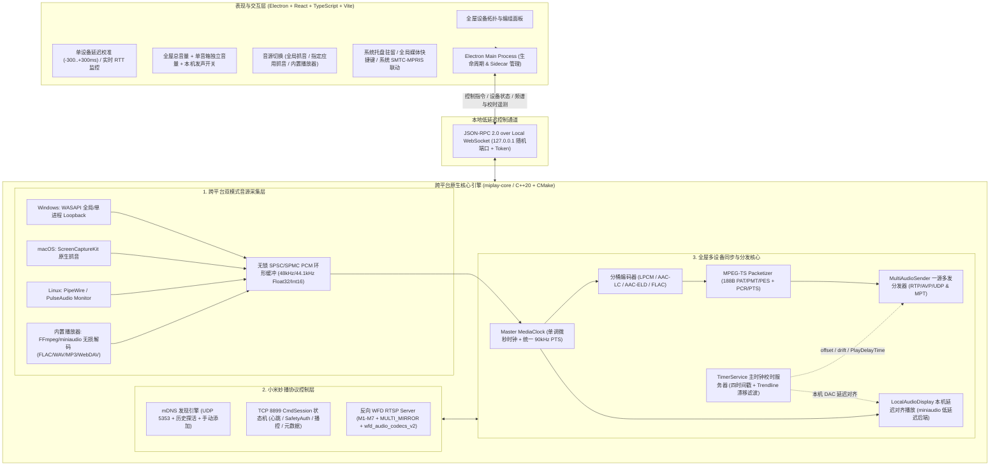

# 独立小米妙播（MiPlay）全屋音频发送端详细实现方案（Electron + 跨平台核心架构）

> **调研基准设备**：REDMI K90 Pro Max（`25102RKBEC` / `myron`），HyperOS `OS3.0`（Android 16），系统 `com.milink.service`（MiPlay Audio `4.0.1.47-releases` / `miaobo_version=2.0`）。  
> **架构定位**：**Electron 跨平台桌面应用（Windows / macOS / Linux）+ 独立跨平台 C++20 协议与同步核心引擎（`miplay-core`）**。核心引擎通过标准 C-ABI / 本地 Sidecar IPC 解耦，后续可零重写协议栈直接交叉编译复用到 **Android（NDK/JNI）** 与 **iOS（XCFramework）**。  
> **核心目标**：完整实现小米妙播发送端协议栈，**硬性保障全屋多设备毫秒级同步播放（Multi-Room Sync）**，并同时支持**系统全局声卡环回抓音（含单应用隔离抓音）**与**内置无损播放器/流媒体推流**。

---

## 1. 架构选型与分层设计

### 1.1 为什么采用「Electron UI + C++20 Sidecar 核心」？

| 关注点 | 纯 Electron / Node.js 实现 | **Electron UI + C++20 Sidecar 核心（本方案）** |
| :--- | :--- | :--- |
| **多设备同步精度** | V8 GC 停顿（10–50ms）会导致 RTP 节拍抖动、校时误差放大、多音箱出现回声 | 无 GC 停顿，独立实时音频线程 + 微秒级单调时钟，稳定控制在 **±1–3ms** |
| **多平台全局抓音** | Node 无法原生调用 WASAPI / ScreenCaptureKit / PipeWire | C++20 原生封装三端系统音频环回接口，性能极低开销（CPU < 3%） |
| **多端复用能力** | 仅限桌面，移动端完全无法复用代码 | 同一套 `libmiplay_core` 可通过 CMake 直接编译为 Windows/macOS/Linux/Android/iOS 核心库 |
| **运行稳定性** | UI 窗口崩溃或刷新会中断音乐 | Sidecar 守护进程与 Electron 渲染进程隔离，UI 关闭到托盘或重载时全屋音频零中断 |
| **构建与维护** | Electron 版本升级频繁导致原生插件 ABI 断裂 | Sidecar 通过本地 WebSocket / JSON-RPC 通信，彻底摆脱 Node ABI 绑定 |

### 1.2 总体分层架构图



---

## 2. 多平台音源采集统一设计

为了同时满足 **系统全局抓音** 与 **内置播放器/流媒体**，核心引擎抽象统一的 `IAudioSource` 接口，所有音源在进入编码与同步引擎前，均统一转换为标准 PCM 流（默认 `48000 Hz / 2ch / 16-bit` 或无损 `44100/48000 Hz 24-bit`，经高质量线性相位重采样器对齐，避免晶振漂移导致的缓冲区上溢/下溢）。

### 2.1 三大桌面平台系统抓音实现策略

| 平台 | 采集后端 | 全局抓音 | 单应用隔离抓音（不录系统提示音） | 附加优势与处理 |
| :--- | :--- | :--- | :--- | :--- |
| **Windows 10/11** | `WASAPI` (`IAudioClient`) | `AUDCLNT_STREAMFLAGS_LOOPBACK` 抓取默认渲染设备 | Windows 10 20H1+ `ActivateAudioInterfaceAsync` + `AUDIOCLIENT_ACTIVATION_TYPE_PROCESS_LOOPBACK`（支持包含/排除指定 PID） | 通过 Windows **SMTC** 自动同步网易云/QQ音乐/Spotify 的歌名、歌手、封面到小爱音箱与电视屏幕 |
| **macOS 12.3+** | `ScreenCaptureKit` (`SCStream`) | `SCContentFilter` 捕获整机桌面音频 | 支持按 `SCRunningApplication` 过滤单个音乐 App | **零虚拟声卡依赖**（无需用户手动安装 BlackHole）；macOS 12.3 以下可回退提示安装虚拟音频设备 |
| **Linux (Ubuntu 等)** | `PipeWire`（优先） / `PulseAudio` | 挂载默认 Sink 的 `.monitor` 节点 | PipeWire 原生支持直接路由单个客户端音频 Node | 通过 **MPRIS D-Bus** 自动获取正在播放的歌曲元数据和封面 |
| **未来 Android / iOS** | Android `AudioPlaybackCapture` / Root `REMOTE_SUBMIX`；iOS `ReplayKit` | 复用同一套 `miplay-core` C-ABI，仅替换平台采集层 | Android 支持 `AudioPlaybackCaptureConfiguration.addMatchingUid` | 协议与全屋同步代码 100% 复用 |

### 2.2 内置播放器与本机防漏音机制
- **内置播放器（`BuiltInPlayerSource`）**：集成 `FFmpeg`（libavformat/libavcodec）解码本地音乐库（FLAC / WAV / ALAC / AAC / MP3 / OGG）、WebDAV、HTTP/HTTPS 音频流，支持歌单、Cue 分轨、原生无损直通（不经操作系统混音器劣化），并直接将封面与歌词/进度送入 TCP 8899 `SetMediaInfo` / `SetPosition`。
- **本机静音与防漏音控制**：
  - 使用内置播放器时，音频直接送入 `miplay-core`，仅当用户开启「本机同步发声」时才打开 `LocalAudioDisplay`，天然不漏音。
  - 使用系统全局环回抓音时，提供两种模式：① **静音本机外放模式**（Windows/Linux 支持将目标应用或默认输出路由至软件静音虚拟节点 / 单独静音物理扬声器输出；或者提示切换至虚拟输出）；② **本机协同全屋齐唱模式**（将本机作为全屋同步组的一个节点，统一做延迟对齐，消除与音箱之间的回声）。

---

## 3. 小米妙播协议栈详细设计（基于 K90 实机实证）

协议栈严格对应从红米 K90 Pro Max（`libaudiomirror-jni.so` + 运行日志）实证的完整四层通信流程：

### 3.1 设备发现层（`DiscoveryEngine`）
1. **mDNS 发现（UDP `5353`）**：
   - 绑定局域网有效物理网卡 IPv4（避免误绑 VPN / Docker / VMware 虚拟网卡导致组播发不出去！多网卡选择界面提供显式网卡切换）。
   - 发送 mDNS 浏览查询并持续监听广播，解析每台接收端的 `name`、`ip`、`port`（默认 `8899`）、`mac`、`deviceType`（`2`=电视/盒子，`3`=PC，`4`=小爱音箱/平板/接收端）、`idhash`、`roomName`、`groupName`、`isMaster`、`supportmpability`。
2. **增强发现能力**：
   - **历史设备列表快速探活**：启动即对上次连接成功的设备并行发起 TCP 8899 探测。
   - **手动添加 IP:Port**：支持跨 VLAN 或路由器屏蔽组播时直接手动添加音箱或 NAS 上的接收端。

### 3.2 TCP `8899` 控制信令通道（`CmdSessionManager`）
每台接收端维持独立非阻塞 TCP 长连接（基于 `asio` / `epoll` / `kqueue` / `IOCP`）：
- **保活**：每 5 秒发送 `HeartBeat`（递增 `seq`），校验 `HeartBeat_Ack`；连续 3 次超时触发平滑重连。
- **鉴权与密钥协商**：按设备能力自动适配明文/轻量通道或安全加密通道（`SafetyInfo` → `SafetyAuth` → `SetMirrorKey`，原生内置 `OpenSSL` / `mbedTLS` 提供 `AES-128-CBC/CTR` 与 `Ed25519`）。
- **完整控制命令集**：
  - 初始化与能力：`GetDeviceInfo`、`SetLocalDeviceInfo`（上报设备名、能力标志）
  - 推流与全屋管理：`OpenDevice` / `OpenAVDevice`、`CloseDevice`、`AddMirror`、`DelMirror`、`ExitMirror`
  - 时钟同步联动：`SetTimeOffset`、`AddTimeOffset`
  - 播控、音量与元数据：`SetVolume`、`GetVolume`、`MuteAudio`、`PauseDevice`、`ResumeDevice`、`FlushDevice`、`SetMediaInfo`、`SetMediaState`、`SetPosition`、`SetSeekDone`

### 3.3 反向 WFD RTSP 协商层（`WfdRtspServer`）

发送端在本地监听动态 TCP 端口作为 **WFD RTSP Server**，通过 TCP `8899` 的 `OpenDevice` / `AddMirror` 通知接收端反连，完成 M1–M7 及小米私有扩展协商：

```mermaid
sequenceDiagram
    participant C as miplay-core (Sender / WFD Source)
    participant S1 as 小爱音箱 A (Sink 1)
    participant S2 as 小米盒子/音箱 B (Sink 2)

    Note over C,S2: 第一阶段：发现与 8899 控制建连
    C->>S1: TCP 8899 Connect + SafetyInfo/SafetyAuth + GetDeviceInfo
    C->>S2: TCP 8899 Connect + SafetyInfo/SafetyAuth + GetDeviceInfo

    Note over C,S2: 第二阶段：全屋主会话初始化 & 节点加入
    C->>C: 启动 TimerService (主时钟端口 T_port) + WfdRtspServer (端口 R_port)
    C->>S1: 8899 OpenDevice(SenderIP, R_port, T_port, AudioOnly)
    S1->>C: TCP Connect R_port (反向 WFD RTSP 建连)
    C<->S1: M1-M4 (OPTIONS, GET/SET_PARAMETER: wfd_audio_codecs_v2, wfd_content_SP_protection)
    C->>S1: MULTI_MIRROR rtsp://localhost/wfd1.0 (MultiPort, TimeOffset)
    S1-->>C: 200 OK
    C<->S1: M5-M7 (SETUP RTP/AVP/UDP 或 MPT -> PLAY)
    S1<->C: TimerClient <-> TimerService 初始快速校时 (3轮收敛)

    Note over C,S2: 第三阶段：播放中途热添加设备 B (音箱 A 零中断)
    C->>S2: 8899 OpenDevice / AddMirror(SenderIP, R_port, T_port)
    S2->>C: TCP Connect R_port -> M1-M7 + MULTI_MIRROR + TimerService 初始校时
    C->>C: 在下一个音频整帧边界将 S2 挂载至 MultiAudioSender 分发列表
    C->>S2: 补发当前 SetMediaInfo + SetVolume + SetPosition

    Note over C,S2: 第四阶段：全屋毫秒级同步推流
    loop 每 10~20ms 音频帧
        C->>S1: RTP/MPT (MPEG-TS, 统一 PTS = T_master + PlayDelayTime)
        C->>S2: RTP/MPT (MPEG-TS, 统一 PTS = T_master + PlayDelayTime)
    end
```

---

## 4. 全屋多设备同步核心（Multi-Room Sync）深度设计

这是整个项目的**核心技术壁垒与最关键验收指标**，设计目标为：**多台设备间物理出声误差 ≤ ±5ms（人耳完全无回声），连续播放 4 小时以上零累积漂移，动态加减设备不停播**。

### 4.1 统一主时钟与时间轴（`MasterMediaClock`）
- 发送端维护唯一单调主时钟 `T_master`（Linux `CLOCK_MONOTONIC_RAW` / Windows `QueryPerformanceCounter` / macOS `mach_continuous_time`，统一换算为微秒 `int64_t`）。
- 音频采集按固定帧长（例如 AAC-LC 48kHz 每帧 1024 samples = `21.333ms`，LPCM 48kHz 每帧 480 samples = `10.0ms`）推进严格连续的样本计数时钟 `T_audio_pts`，并与 `T_master` 锁定基准点 `T_origin`：
  $$\text{PTS}_{\text{90kHz}} = \left\lfloor \frac{(T_{\text{origin}} + \text{sample\_index} / F_s + D_{\text{play}}) \times 90000}{10^6} \right\rfloor \bmod 2^{33}$$
- 其中 $D_{\text{play}}$（`PlayDelayTime`，默认 `350ms`，弱网可自适应上调至 `500ms`）确保所有 Wi-Fi 音箱都有充足的抖动吸收缓冲。

### 4.2 `TimerService` 高精度主从校时与晶振漂移抑制
每台接收端运行 `TimerClient` 与发送端 `TimerService` 交互（每 2~5 秒一次周期校时，刚入群时前 3 秒每秒 2 次快速收敛）：
1. **四时间戳测算**：
   $$\text{RTT} = (T_4 - T_1) - (T_3 - T_2), \qquad \Delta_{\text{raw}} = \frac{(T_2 - T_1) + (T_3 - T_4)}{2}$$
2. **Wi-Fi 抖动滤波（Min-RTT Window + `TrendlineEstimator`）**：
   - Wi-Fi 信道竞争会产生非对称突发延迟（几十毫秒尖峰）。采用最近 16 组样本中 **RTT 最小的 Top-25% 样本** 参与加权计算，直接丢弃拥塞尖峰。
   - 对平滑后的 $\Delta(t)$ 做在线线性回归，实时估计出该音箱相对发送端的 **瞬时偏移 `offset_us`** 与 **晶振频偏 `drift_ppm`**。
3. **平滑下发与抗跳变**：
   - 当估算偏移变化超过阈值（例如 `> 2ms`）时，通过控制通道 `SetTimeOffset` / `AddTimeOffset` 或 RTSP `TimeOffset` 平滑下发，避免单次大幅跳变导致音箱爆音。

### 4.3 硬件固有延迟差校准（跨型号设备齐唱必杀技）
即使网络时钟误差为 `0ms`，不同硬件的内部 DSP/DAC 链路延迟依然不同（例如：小爱音箱内部延迟 ~30ms，而小米电视经 HDMI eARC 到回音壁可能高达 ~110ms）。本方案提供三层保障：
1. **单设备手动微调（`-300ms ~ +300ms`，1ms 精度）**：播放时实时拖动该设备滑块，通过调整发往该设备的偏移量/PTS 补偿实时听到对齐效果，配置按设备 `MAC` 自动持久化。
2. **本机延迟自动补偿（`LocalAudioDisplay`）**：通过 `miniaudio` / WASAPI / CoreAudio / PipeWire 查询本机音频流硬件缓冲延迟，精准扣减后再按 `PlayDelayTime` 时刻出声。
3. **预设设备延迟档案**：内置常见小米音箱、小米电视/盒子默认延迟补偿表，开箱即准。

### 4.4 一源多发与编码分桶调度（`MultiAudioSender`）
- **编码分桶（Codec Buckets）**：按当前活跃设备协商出的 `(Codec, SampleRate)` 分桶。若 5 台音箱都支持 `AAC 48kHz` 或 `LPCM 48kHz`，则只运行 **1 个编码器 + 1 个 TS 打包器**，打包好的 MPEG-TS 负载通过多路发送器分别加上各设备的 RTP 头（独立 SSRC / Seq）/ 加密层 / MPT 封装发出。
- **异步非阻塞隔离发送**：每个接收端拥有独立发送队列（上限 500ms），单台音箱网络卡顿或丢包不会反压阻塞音频采集线程，也不会影响其他房间音箱的播放节拍。
- **编码器选型**：
  - `LPCM`：零编码开销、无损、最低延迟（约 1.536 Mbps/台，Wi-Fi 5/6 下 5 台也仅 ~7.7 Mbps）；
  - `AAC-LC / AAC-ELD`：采用 `fdk-aac` 或系统原生硬件编码器（MediaFoundation / AudioToolbox / FFmpeg），兼容性最强、带宽极低（~256 kbps/台，适合多设备复杂 Wi-Fi 环境）；
  - `FLAC`：采用 `libflac`，适用于支持 `wfd_audio_codecs_v2` 的高保真接收端。

---

## 5. 工程目录结构与本地 IPC 契

### 5.1 Monorepo 目录结构（工作区 `/home/ty/K90/mishare`）

```text
/home/ty/K90/mishare/
├── docs/
│   ├── MIPLAY_SENDER_DESIGN.md         # 本总体架构与实现设计文档
│   └── PROTOCOL_WIRE_SPEC.md           # M0 真机抓包产出的字节级协议规范
├── tools/                              # M0 协议抓取、解析与 Python 快速原型
│   ├── capture_k90.sh                  # 红米 K90 一键抓取 tcpdump + miplay 日志
│   ├── dissect_miplay.py               # 8899 / RTSP / TimerService 离线解析器
│   └── miplay_sender_poc.py            # Python 最小发送端原型（单播 + 双机同步验证）
├── core/                               # 跨平台 C++20 核心引擎 (CMake)
│   ├── CMakeLists.txt
│   ├── include/miplay_core/            # 对外稳定 C-ABI 头文件（供 Desktop/Android/iOS 共用）
│   ├── src/
│   │   ├── discovery/                  # mDNS 发现器 + 多网卡绑定 + 历史探活
│   │   ├── cmd/                        # TCP 8899 二进制帧编解码 + SafetyAuth + 心跳状态机
│   │   ├── rtsp/                       # 反向 WFD RTSP Server + MULTI_MIRROR 扩展
│   │   ├── media/                      # LPCM/AAC/FLAC 编码 + MPEG-TS + RTP/UDP & MPT
│   │   ├── sync/                       # MasterMediaClock + TimerService + TrendlineEstimator
│   │   ├── audio_capture/              # Windows(WASAPI) / macOS(SCK) / Linux(PipeWire) / 内置解码
│   │   ├── audio_render/               # LocalAudioDisplay (miniaudio 本机对齐输出)
│   │   └── sidecar/                    # 本地 WebSocket JSON-RPC 服务端（供 Electron 调用）
│   └── tests/                          # 协议编解码单测 + 时钟同步仿真测试
├── desktop/                            # Electron 桌面客户端 (TypeScript + React + Vite)
│   ├── package.json
│   ├── electron/                       # Main & Preload 进程（Sidecar 托管、托盘、快捷键、自动更新）
│   ├── src/
│   │   ├── components/                 # 设备卡片、全屋拓扑、延迟校准滑块、频谱图
│   │   ├── stores/                     # Zustand 状态管理（与 Sidecar 事件实时同步）
│   │   ├── services/                   # JSON-RPC WebSocket 客户端
│   │   └── pages/                      # 全屋播放主控台 / 本地曲库播放器 / 协议诊断日志页
│   └── build/                          # electron-builder 打包配置 (NSIS / DMG / AppImage / deb)
└── mobile/                             # (预留) 后续 Android / iOS 壳工程，直接链接 core/
```

### 5.2 Electron ↔ `miplay-core` Sidecar 本地 IPC 协议概要
- **启动安全**：Electron Main 进程拉起 `miplay-core-sidecar`，通过标准输出回传监听的 `127.0.0.1:<ephemeral_port>` 与一次性随机 `auth_token`，杜绝端口冲突与跨站访问风险。
- **核心 RPC 方法**：
  - 发现与设备：`discovery.start` / `discovery.listInterfaces` / `device.addManual` / `device.getInfo`
  - 音源切换：`source.listApps`（枚举可单应用抓音列表）/ `source.selectSystemLoopback` / `source.selectAppLoopback` / `source.loadMediaTrack`
  - 全屋播放控制：`multiroom.start` / `multiroom.addDevice` / `multiroom.removeDevice` / `multiroom.stop` / `multiroom.setLocalPlayback`
  - 同步与音量：`sync.setBaseDelay` / `sync.setDeviceBias` / `volume.setMaster` / `volume.setDevice` / `playback.control`
- **高频推送事件（Sidecar → UI）**：
  - `event.deviceUpdated`、`event.syncTelemetry`（每 500ms 推送各音箱 RTT、offset、丢包率、缓冲水位）、`event.metadataChanged`、`event.spectrumFrame`（30fps 轻量 FFT 柱状图数据）。

---

## 6. 当前开发环境评估

已对当前开发机与调试真机完成检测：
- **开发宿主机（Ubuntu Linux x86_64）**：`Node.js v24.15.0`、`npm 11.12.1`、`CMake`、`g++`、`Python 3`、`adb 37.0.3` 均已就绪，可直接搭建 Electron 前端与 C++20 `miplay-core` 工程。
- **红米 K90 Pro Max 真机（`192.168.5.84:5555`）**：已拥有 `root` 权限且内置 `/system/bin/tcpdump`、`/system/bin/ss`，可直接开展 **M0 阶段真实协议抓包**。
- **跨平台打包支持**：Linux 原生编译测试，后续通过 GitHub Actions CI（Windows / macOS / Linux runners）即可一键产全平台安装包（`.exe` / `.dmg` / `.AppImage` / `.deb`）。

---

## 7. 分阶段实施路线图（Milestones）

| 阶段 | 核心交付物 | 验收标准 |
| :--- | :--- | :--- |
| **M0：真机抓包 & 协议字节级定稿** | 在红米 K90 上运行 `tools/capture_k90.sh`，抓取向局域网小爱音箱发起 **单播** 与 **全屋双播** 的完整流量；产出 `PROTOCOL_WIRE_SPEC.md` 与 `miplay_sender_poc.py` | Python 原型在开发机上运行即可发现你局域网中的小爱音箱，完成 8899 鉴权 + RTSP 握手 + 推流发声，并实测双音箱 `MULTI_MIRROR` + `TimerService` 同步 |
| **M1：C++20 `miplay-core` 单播闭环** | 完成 CMake 工程、`DiscoveryEngine`、`CmdSessionManager`、`WfdRtspServer`、`LPCM/AAC + MPEG-TS + RTP` 发送器及内置测试音源 | 独立原生程序在 Linux 上向真实小爱音箱/小米盒子稳定推送音乐，支持音量、暂停、歌名元数据同步 |
| **M2：全屋多设备毫秒级同步引擎** | 完成 `MasterMediaClock`、`TimerService`（含 `TrendlineEstimator` 漂移抑制）、`MultiAudioSender` 分桶多发、动态热增删、`LocalAudioDisplay` 与单设备延迟微调 | 同时向 2 台及以上音箱 + 本机播放，人耳无回声（实测偏差 ≤ 5ms），中途热加减音箱零断流，长播 2 小时无漂移 |
| **M3：跨平台声卡抓音 + Electron 桌面端** | 完成 Linux PipeWire/PulseAudio（及 Windows WASAPI / macOS SCK 适配层）、FFmpeg 内置播放器、Sidecar JSON-RPC；搭建 Electron + React 全屋主控台 UI 与托盘 | 在桌面端一键把电脑系统声音或本地无损歌曲同步投送到全屋小米音箱，支持独立音量、延迟滑块与实时 RTT 监控 |
| **M4：兼容性打磨、MPT/FLAC 与全平台打包** | 完善 `RTP/AVP/MPT` 弱网抗丢包、FLAC 无损协商、断网自动重连、多网卡选择及三端 CI 打包（Win/macOS/Linux） | 覆盖局域网内全部真实小米与兼容接收端稳定运行，并验证 `libmiplay_core` C-ABI 跨端接口完备性 |
